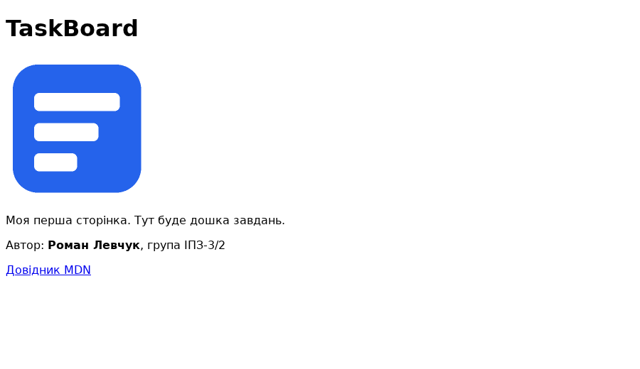
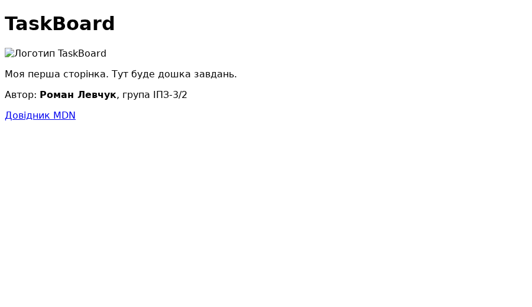
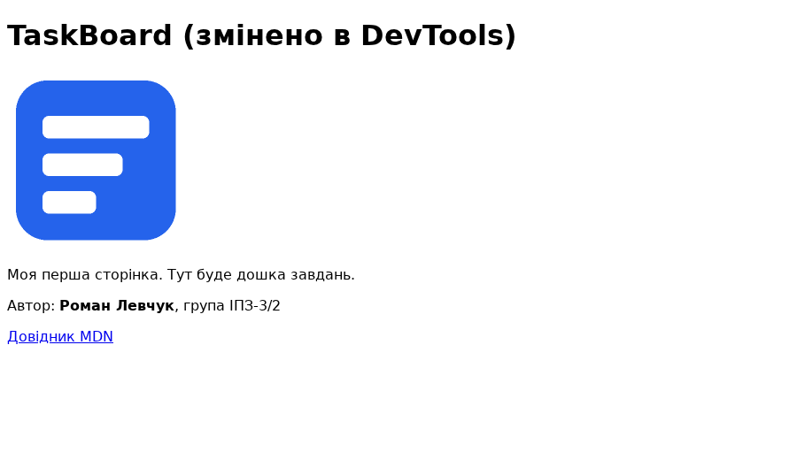
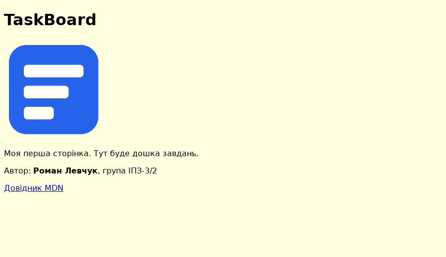

# Звіт до лабораторної 2. Перша сторінка

Автор: Роман Левчук, група ІПЗ-3/2

## Network (index.html + logo.png)

| Запит (Name) | Метод | Статус | Тип | Розмір |
|---|---|---|---|---|
| index.html | GET | 200 | document | 461 B |
| logo.png | GET | 200 | png | 2505 B |

Заголовки запиту `index.html`:

- Request URL: `http://127.0.0.1:5500/index.html`
- Request Method: `GET`
- Status Code: `200 OK`
- Content-Type: `text/html`



## Помилка 404

Після зміни шляху на `images/logo1.png` у Network з'явився запит `logo1.png` зі статусом **404 Not Found** (Content-Type: `text/html;charset=utf-8`, 335 B). На сторінці замість картинки показався текст з атрибута `alt`.



## Elements

Я змінив текст заголовка в Elements. На сторінці він змінився, але файл `index.html` на диску залишився без змін. Після F5 заголовок знову став «TaskBoard».



## Console

- `document.title` повернула `"TaskBoard"`.
- `document.body.style.background = "lightyellow"` повернула `"lightyellow"` і зробила фон сторінки світло-жовтим. Після F5 фон повернувся до білого, бо зміна була лише в пам'яті браузера.



## Відповіді на запитання

1. **Яка адреса сторінки в браузері? З яких частин вона складається?** Адреса `http://127.0.0.1:5500/index.html`. Протокол `http`, хост `127.0.0.1` (мій власний комп'ютер), порт `5500` і шлях до файлу `/index.html`.
2. **Скільки запитів зробив браузер і чому?** Два: спершу `index.html`, а потім `logo.png`, бо браузер знайшов у HTML тег `` і докачав зображення. Посилання на MDN не завантажується, доки на нього не натиснути.
3. **Що відбулось при неправильному шляху до зображення?** Сервер відповів статусом 404, у Network з'явився червоний запит, а на сторінці замість картинки показався альтернативний текст.
4. **Чому зміни через DevTools зникли після F5?** DevTools змінюють лише копію сторінки в пам'яті браузера (DOM). Файл на диску не змінюється, а F5 завантажує його з сервера заново.
5. **Хто клієнт, а хто сервер?** Клієнт: браузер. Сервер: Live Server на `127.0.0.1:5500`, який віддає файли з папки проєкту.


# Звіт до лабораторної 4. Git у терміналі

## Історія репозиторію

```
630e26e Об'єднати варіанти заголовка
1c6aa71 Розширити заголовок
d453b81 Перекласти заголовок українською
afee0d2 Додати сторінку про проєкт
526beea Додати опис проєкту на головну
6b7db46 Додати логотип, звіт і .gitignore
94b1b98 Додати головну сторінку
```

Графічний вигляд (`git log --oneline --graph`):

```
*   630e26e Об'єднати варіанти заголовка
|\
* | 1c6aa71 Розширити заголовок
| * d453b81 Перекласти заголовок українською
|/
* afee0d2 Додати сторінку про проєкт
* 526beea Додати опис проєкту на головну
* 6b7db46 Додати логотип, звіт і .gitignore
* 94b1b98 Додати головну сторінку
```

## Відповіді на запитання

1. **Що змінилося у виводі `git status` після `git add`?** Файл перейшов зі списку Untracked (або Changes not staged) до зеленого списку Changes to be committed, тобто потрапив в індекс.
2. **Що показує `git diff`?** Різницю між робочою копією і тим, що вже в індексі або в останньому commit-і. Рядки з `+` додані, з `-` видалені.
3. **Чим відрізняється `git switch main` від `git merge`?** `git switch` лише перемикає поточну гілку і змінює файли в робочій папці. `git merge` вливає зміни іншої гілки в ту, на якій я зараз стою.
4. **Чому виник конфлікт і як я його розв'язав?** У гілках `main` і `ukr-title` я по-різному змінив один і той самий рядок `<h1>`. Git не знав, який варіант обрати, і залишив у `index.html` службові маркери. Я об'єднав обидва варіанти в `<h1>Дошка завдань: керуй завданнями</h1>`, прибрав рядки `<<<<<<<`, `=======` і `>>>>>>>`, а потім виконав `git add index.html` та `git commit`.
5. **Скільки commit-ів у моїй історії?** До фінального commit-у було 7, разом із фінальним (`Додати звіт до лабораторної 4`) стало 8. Вивід `git log --oneline` наведено вище.


# Звіт до лабораторної W-07. Сторінка «Про автора»

Семантична розмітка описує зміст сторінки, а не лише її вигляд: `header`, `nav`, `main`, `section`, `article` і `footer` прямо називають роль блоку. Завдяки цьому сторінку краще розуміють пошукові системи та програми для незрячих користувачів. Такий код також легше читати й підтримувати, ніж купу однакових `div`.

Використані теги: `html`, `head`, `meta`, `title`, `body`, `header`, `nav`, `main`, `section`, `article`, `footer`, `h1`, `h2`, `p`, `a`, `img`, `figure`, `figcaption`, `strong`, `em`, `ul`, `li`, `table`, `thead`, `tbody`, `tr`, `th`, `td`.
