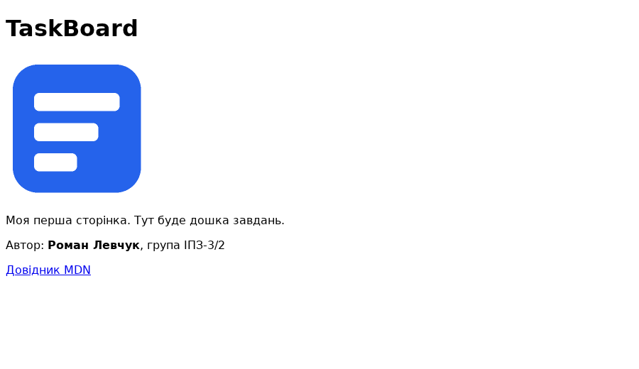
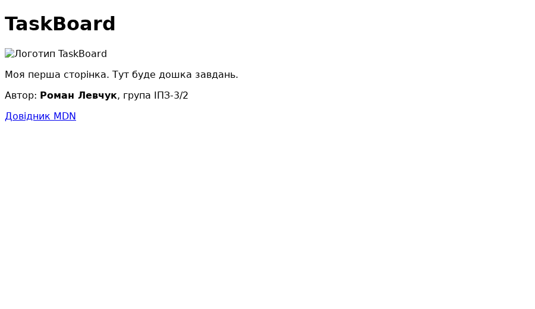
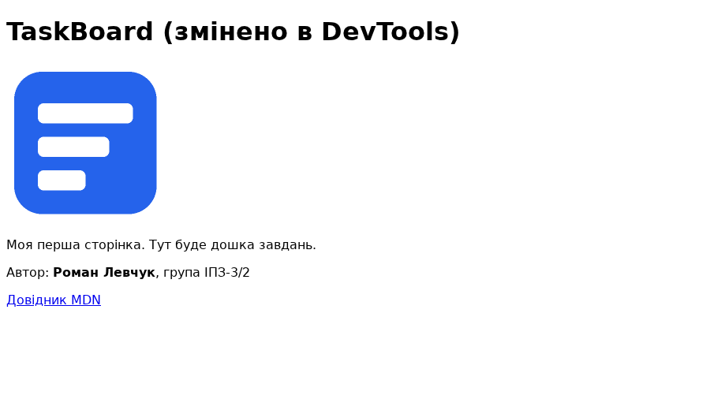
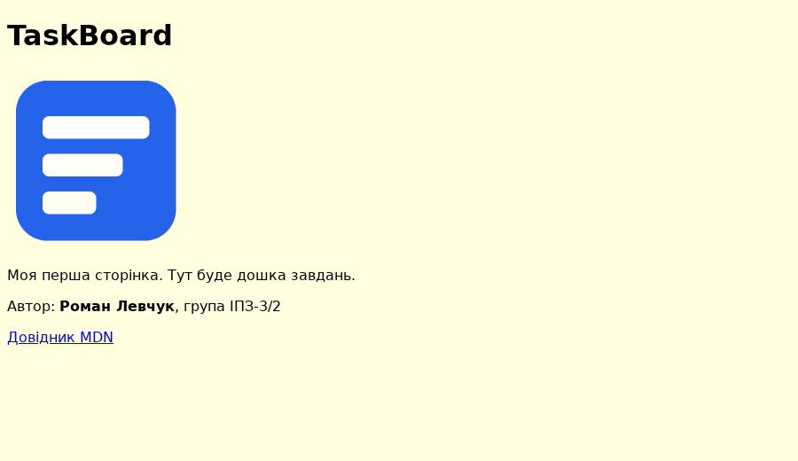

# Звіт до лабораторної 2. Перша сторінка

Автор: Роман Левчук, група ІПЗ-3/2

## Network (index.html + logo.png)

| Запит (Name) | Метод | Статус | Тип | Розмір |
|---|---|---|---|---|
| index.html | GET | 200 | document | 461 B |
| logo.png | GET | 200 | png | 2505 B |

Заголовки запиту `index.html`:

- Request URL: `http://127.0.0.1:5500/index.html`
- Request Method: `GET`
- Status Code: `200 OK`
- Content-Type: `text/html`

## Помилка 404

Після зміни шляху на `images/logo1.png` у Network з'явився запит `logo1.png` зі статусом **404 Not Found** (Content-Type: `text/html;charset=utf-8`, 335 B). На сторінці замість картинки показався текст з атрибута `alt`.

## Elements

Я змінив текст заголовка в Elements. На сторінці він змінився, але файл `index.html` на диску залишився без змін. Після F5 заголовок знову став «TaskBoard».

## Console

- `document.title` повернула `"TaskBoard"`.
- `document.body.style.background = "lightyellow"` повернула `"lightyellow"` і зробила фон сторінки світло-жовтим. Після F5 фон повернувся до білого, бо зміна була лише в пам'яті браузера.

## Відповіді на запитання

1. **Яка адреса сторінки в браузері? З яких частин вона складається?** Адреса `http://127.0.0.1:5500/index.html`. Протокол `http`, хост `127.0.0.1` (мій власний комп'ютер), порт `5500` і шлях до файлу `/index.html`.
2. **Скільки запитів зробив браузер і чому?** Два: спершу `index.html`, а потім `logo.png`, бо браузер знайшов у HTML тег `` і докачав зображення. Посилання на MDN не завантажується, доки на нього не натиснути.
3. **Що відбулось при неправильному шляху до зображення?** Сервер відповів статусом 404, у Network з'явився червоний запит, а на сторінці замість картинки показався альтернативний текст.
4. **Чому зміни через DevTools зникли після F5?** DevTools змінюють лише копію сторінки в пам'яті браузера (DOM). Файл на диску не змінюється, а F5 завантажує його з сервера заново.
5. **Хто клієнт, а хто сервер?** Клієнт: браузер. Сервер: Live Server на `127.0.0.1:5500`, який віддає файли з папки проєкту.
